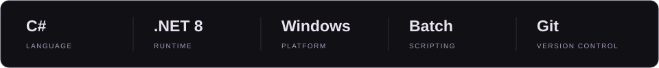

  

  WINDOWS UTILITIES &nbsp; / &nbsp; GAME TOOLS &nbsp; / &nbsp; SMALL EXPERIMENTS

 

### About this corner

I'm **Elivien**, also known as **Muiqy**. This is my little archive of tools, patches and experiments — from making Terraria fit an ultrawide screen to putting Windows scripts behind a convenient interface.

  

### Selected work

<table>
  <tr>
    <td width="50%" valign="top">
      01 &nbsp; / &nbsp; GAME TOOLS
      <h3><a href="https://github.com/Muiqy/Terraria-Ultra-wide-monitor-patcher">Terraria Ultrawide Patcher ↗</a></h3>
      
More room for the world. An ultrawide patcher for Terraria 1.4.5.3 that adjusts zoom and resolution limits, with a backup before every patch.

      
C# &nbsp; · &nbsp; .NET 8 &nbsp; · &nbsp; WINDOWS

    </td>
    <td width="50%" valign="top">
      02 &nbsp; / &nbsp; WINDOWS UTILITIES
      <h3><a href="https://github.com/Muiqy/Elysiumv2.0">Elysium ↗</a></h3>
      
A convenient interface for batch presets, service management and diagnostics. Less jumping between scripts; more control in one place.

      
BATCH &nbsp; · &nbsp; SERVICES &nbsp; · &nbsp; DIAGNOSTICS

    </td>
  </tr>
</table>

  ALSO IN THE ARCHIVE 
  <a href="https://github.com/Muiqy/CSTM-recode">CSTM-recode</a> &nbsp; / &nbsp;
  <a href="https://github.com/Muiqy/Elysium-fix">Elysium-fix</a> &nbsp; / &nbsp;
  <a href="https://github.com/Muiqy?tab=repositories">All repositories ↗</a>

 

### On the workbench

  

  
  ☾ &nbsp; A quiet corner of the internet. &nbsp; / &nbsp; <a href="https://github.com/Muiqy?tab=repositories">Explore the archive</a> &nbsp; ✦

