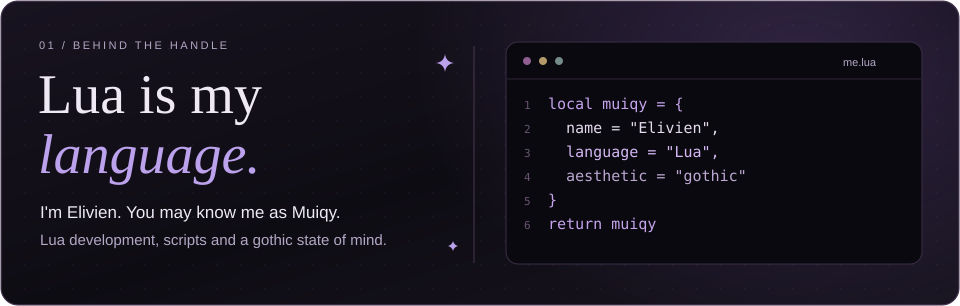
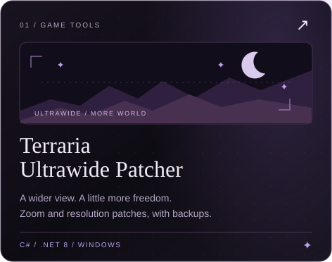
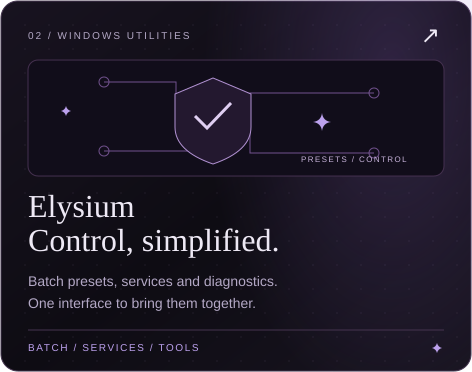
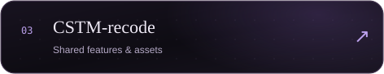
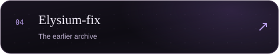
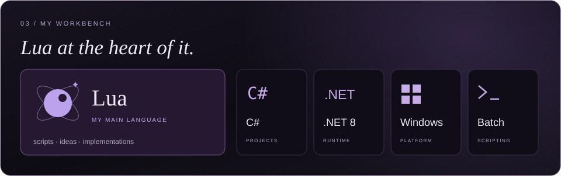
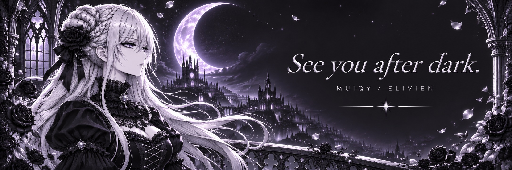

<!-- Custom profile artwork. Text alternatives are available below. -->

Text version &amp; project links

## Elivien / Muiqy

**Lua developer.** Lua is my main language and what people know me for.

### Featured Lua project

[muiqy.lua](https://github.com/Muiqy/Muiqy/blob/main/LUA-PROJECT.md) — a learning experiment with animated text labels for GameSense / CS:GO: HEX colors, interpolation and three animation modes.

### Other public projects

- [Terraria Ultrawide Patcher](https://github.com/Muiqy/Terraria-Ultra-wide-monitor-patcher) — a C# / .NET 8 utility for Terraria zoom and resolution limits, with backups.
- [Elysium](https://github.com/Muiqy/Elysiumv2.0) — batch presets, service management and diagnostics in one interface.
- [CSTM-recode](https://github.com/Muiqy/CSTM-recode) — shared features and assets.
- [Elysium-fix](https://github.com/Muiqy/Elysium-fix) — earlier archive.

[Browse all repositories](https://github.com/Muiqy?tab=repositories)

